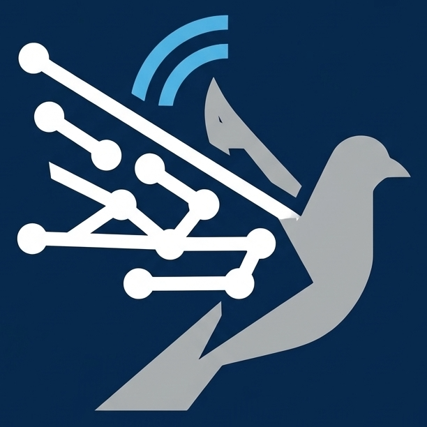

<div id="top">

<!-- HEADER STYLE: CLASSIC -->
<div align="center">



# CarrierPigeons

**Continuous Telemetric Documentation Pipeline**  
*Unleash the Pigeons!*  

~ Built with ~ 


~ for ~

  
  
  
  

</div>

<br>

---

<div align="center">

**Note: This project is WIP**

## Overview

</div>

**CarrierPigeons** is a lightweight, production-ready Continuous Telemetric Documentation pipeline that collects system metrics from edge devices and reliably delivers them to centralized storage via MQTT—complete with robust state management, batch processing, and graceful lifecycle handling. Included Runner system provides both out-of-the-box & extensively custom executable functions such as stress-testing & benchmarking nodes, integrated natively in the **CarrierPigeons** system.

!!! Please note that this project is very much in active development and work-in-progress. **CarrierPigeons** is currently undergoing design expansion into an importable SDK with robust distributed node execution harness capabilities. Stay tuned!! :) 

**Why CarrierPigeons?**

This project empowers developers to build scalable, observable infrastructure monitoring systems without reinventing core pub/sub, storage, and resilience patterns. Transitioning beyond passive logging, CarrierPigeons acts as a proactive edge observability layer, heavily optimized for AI inference hardware, multi-node clusters, and Open Research environments. All managed through centralized CLI & TUI PigeonCommand tool. 

<br>

---

<div align="center">

## Features

</div>

|      | Component       | Details                                                                                                                                                                                                                                                                 |
| :--- | :-------------- | :---------------------------------------------------------------------------------------------------------------------------------------------------------------------------------------------------------------------------------------------------------------------- |
| 🚀   | **Pigeoneer Edge Agent**| **Hardware-Agnostic Collectors:** Auto-detects and independently polls Nvidia, AMD, Apple, and Intel GPUs alongside Linux/OpenWrt/macOS/Windows host and network telemetry. **AI Accelerator Support:** Dedicated Hailo, Google Coral, & Apple ANE NPU support featuring PCIe device isolation and array scaling. **State Awareness:** Event-driven heartbeat architecture utilizing MQTT Last Will and Testament (LWT) registries.
| 🏰   | **PigeonCoop Ingestion**| **Robust Storage:** PostgreSQL (`pgxpool`) powered CTD Ledger, Artifact, and Trace DAG persistence (`pkg/adapters/db`) with automated, zero-touch DDL schema migrations at startup. **Event Watchdog:** Native Ntfy integration for instant webhook alerts on offline or degraded hardware nodes.
| 🧠   | **Observability & AI** | **PigeonMCP Sidecar:** Standalone Model Context Protocol (MCP) server enabling tools like Ollama, Claude, ChatGPT, and more to query the CTD Ledger and Artifact Lineage DAG natively. **PigeonCommand:** Interactive CLI/TUI (`pigeons`) for live diagnostics, runner dispatch, and **PigeonCare+** AI-assisted incident triage.
| ⚙️   | **Architecture**  | **Modular Go Monorepo:** Structured using standard `cmd/`, `internal/`, and `pkg/` layouts. **Zero-Friction Deployment:** Compiles to static binaries with `CGO_ENABLED=0`, enabling clean cross-compilation for RISC-V (`riscv64`), ARM (`arm64`), and x86 (`amd64`) architectures. |

<br>

---

<div align="center">

## Project Structure

</div>

~~~sh
└── /
    ├── cmd/
    │   ├── pigeoncoop/   # The CTD ingestion & ledger engine
    │   ├── pigeoneer/    # The edge telemetry & runner agent
    │   ├── pigeonmcp/    # The Model Context Protocol (MCP) sidecar
    │   └── pigeons/      # The PigeonCommand CLI/TUI orchestrator
    ├── deployments/
    │   ├── compose/      # Local Docker Compose stack (Mosquitto, PostgreSQL, Ntfy)
    │   └── install-pigeoneer.sh
    ├── internal/
    │   ├── pigeoncoop/
    │   │   └── broker/     # MQTT subscriber, event watchdog, and LWT Ntfy registry
    │   ├── pigeoneer/
    │   │   ├── collectors/ # Platform & accelerator sensors (Linux, OpenWrt, macOS, Windows, GPU, NPU)
    │   │   ├── relay/      # FIFO offline spooler, MQTT publisher, LWT, and runner dispatcher
    │   │   └── runners/    # Built-in remote execution workloads (benchmark)
    │   └── pigeons/
    │       ├── adapters/   # Multi-provider LLM & SQL tool adapters (Ollama, Claude, OpenAI, vLLM, llama.cpp)
    │       ├── cli/        # Cobra CLI subcommands (ps, list, node, coop, runner)
    │       └── tui/        # Bubble Tea PigeonCare+ interactive triage agent
    └── pkg/
        ├── adapters/db/    # BaseDB storage contract & PostgresStore (Ledger, Artifacts, Traces)
        ├── core/           # Canonical CTDPayload (Observer, Runner, Tracer), topics, and interfaces
        └── runner/         # Extensible remote Runner registry and control envelope
~~~


---

// Built by

```go
package drewvlabs // Drew Vandagriff — Indie Systems & RISC-V Research

var Ethos = [5]string{
	"Simplicity in Architecture",
	"Efficiency in Engineering",
	"Purity in Science",
	"Audacity in Art",
	"Life in Logic",
}
```
